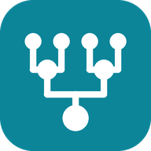
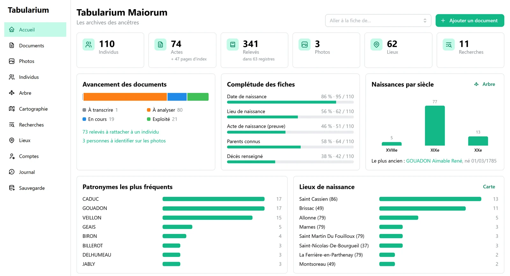
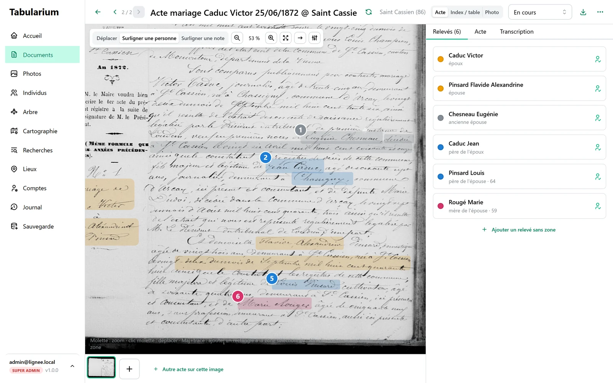
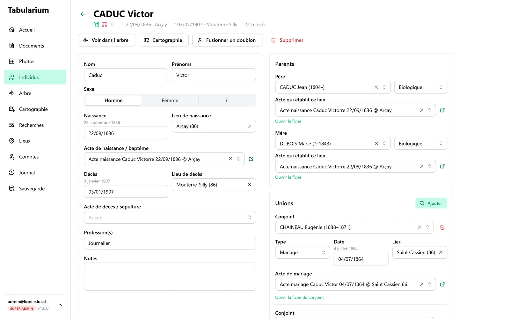
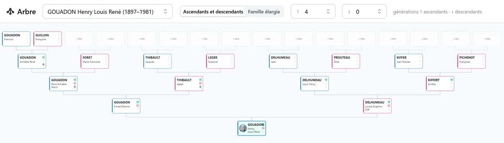
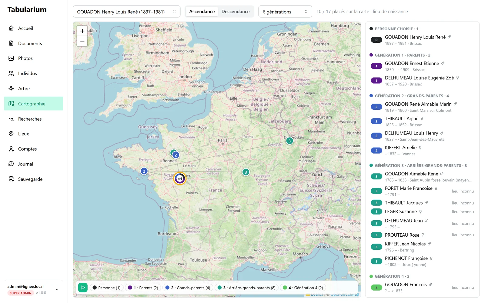
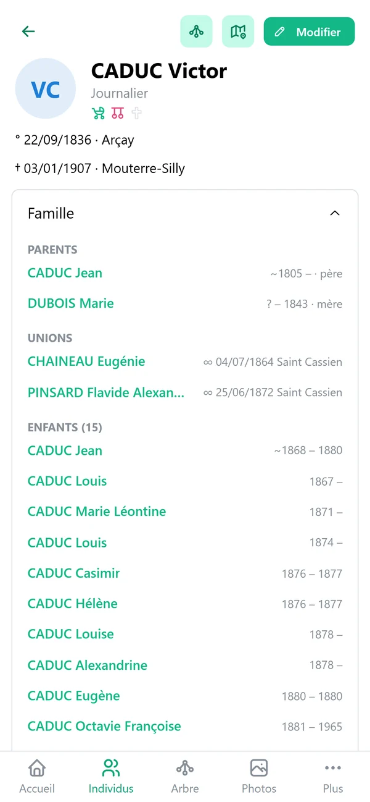

<p align="center">
  
</p>

<h1 align="center">Tabularium Maiorum</h1>

<p align="center">
  <em>Les archives des ancêtres</em> — logiciel libre de recherche généalogique, seul ou en famille.
</p>

<p align="center">
  <a href="LICENSE"></a>
  
  
</p>

À Rome, le *tabularium* était le bâtiment où l'on conservait les archives publiques ; les *maiores*, ce sont les
ancêtres. Tabularium Maiorum est l'atelier où l'on rassemble les traces laissées par les siens, où on les lit, où on
les recoupe, et d'où l'on reconstruit leur histoire. Au quotidien, on dit simplement **Tabularium**.



## Pourquoi cet outil

Une recherche généalogique commence toujours de la même façon : des dizaines d'actes téléchargés sur les sites des
archives départementales, des photos de famille dont plus personne ne connaît tous les visages, des notes prises en
salle de lecture, des tableaux qui se contredisent. Les logiciels de généalogie classiques partent de l'arbre : on y
saisit des conclusions, et les documents qui les justifient restent ailleurs.

Tabularium fait l'inverse : **il part des documents**. Une conclusion n'est jamais saisie à la main, elle se déduit de
ce que disent les sources. On travaille comme un enquêteur : on relève, on compare, on vérifie, et l'arbre n'est que le
résultat de ce travail. Quand deux actes ne disent pas la même chose, on le voit ; quand une branche ne repose sur
aucune preuve, on le sait.

## Comment ça marche

| | Étape | |
|:-:|---|---|
| 1 | **Rassembler** | Actes d'état civil et paroissiaux, tables décennales, photos de famille, papiers retrouvés dans un grenier : chaque document est rangé dans son registre ou son album, avec sa cote. Aux archives, le téléphone photographie un acte et l'envoie directement. |
| 2 | **Relever** | Sur l'image de l'acte, on surligne chaque personne et on note ce qui est écrit, tel quel : nom, âge, profession, domicile, liens. Sur une photo, on entoure les visages pour les identifier. |
| 3 | **Recouper** | Une même personne apparaît dans plusieurs documents : son baptême, son mariage, la naissance de ses enfants, son décès. Tabularium rapproche ces relevés, propose des rattachements, montre ce qui concorde et ce qui se contredit. Quand on hésite entre deux fiches, on les marque « peut-être la même personne » sans les fusionner, jusqu'à ce que le doute soit levé. |
| 4 | **Reconstruire** | Les fiches individuelles et l'arbre se construisent à partir des relevés. Chaque date, chaque lieu, chaque lien de parenté renvoie à l'acte qui le prouve : on sait toujours d'où vient une information. |

<table>
  <tr>
    <td width="50%"></td>
    <td width="50%"></td>
  </tr>
  <tr>
    <td><em>Relever</em> : chaque personne surlignée sur l'acte de mariage, ses relevés à droite.</td>
    <td><em>Reconstruire</em> : la fiche, dont chaque date et chaque lien renvoient à l'acte qui le prouve.</td>
  </tr>
</table>



Et pour ne rien oublier, chaque piste ouverte devient une **recherche** : ce qu'on cherche, où on a déjà regardé
(registre, vues consultées), ce qu'on a trouvé — ou pas.

## Une généalogie qui a une géographie

Nos ancêtres ne sont pas nés nulle part. Ils sont nés ici et là, dans un village, puis un autre ; ils se sont mariés
dans la paroisse voisine ou à l'autre bout du pays, au gré du travail, des guerres, des rencontres. Tabularium place
chaque lieu sur la carte pour rendre cette histoire visible :

- la **cartographie** place l'ascendance ou la descendance d'une personne sur les lieux de naissance, génération par
  génération, et peut les faire apparaître une à une pour suivre les migrations au fil des siècles ;
- le **parcours de vie** de chaque individu relie sur une carte sa naissance, son mariage, les naissances de ses
  enfants et son décès ;
- l'**accueil** mesure la dispersion : dans combien de communes et de départements vos ancêtres sont nés, et où surtout.



## En famille



La généalogie se fait rarement seul. Un cousin a les photos, une tante se souvient des prénoms, un autre fait les
déplacements aux archives. Chacun a son compte : en **lecture** pour consulter l'arbre et les photos, en **écriture**
pour participer. Les modifications apparaissent en direct chez tous, on sait qui a modifié quoi, et deux personnes ne
peuvent pas s'écraser l'une l'autre sans s'en apercevoir.

Sur **téléphone** : consulter l'arbre, retrouver quelqu'un, photographier un acte aux archives. Sur **tablette** :
annoter les actes au doigt. Le site s'installe sur l'écran d'accueil comme une application.

<br clear="right">

## Vos données restent chez vous

Tabularium est un **logiciel libre** ([licence AGPL-3.0](LICENSE)) : gratuit, sans publicité, sans abonnement. Il
s'installe sur votre ordinateur ou sur votre propre serveur ; vos documents et votre arbre ne sont envoyés à aucun
service. Une sauvegarde complète se télécharge en un clic.

## Ce qu'on y trouve

- **Accueil** : l'état de la recherche en un coup d'œil — chiffres clés, avancement des documents, complétude des
  fiches, naissances par siècle, patronymes et lieux, recherches à mener, activité récente.
- **Documents** : actes, tables décennales, photos de famille, rangés par registre ou album.
- **Atelier d'annotation** : zones surlignées sur l'image, relevés tels qu'écrits (nom, âge, profession, filiation…).
- **Individus** : fiches construites à partir des relevés, synthèse des sources, suggestions de rattachement,
  doutes « peut-être la même personne » suivis jusqu'à la fusion ou la vérification, doublons possibles détectés
  automatiquement, homonymes distingués par le nom de leur mère et leur année de naissance (ou un qualificatif).
- **Arbre**, **cartographie** par génération, **parcours de vie** sur carte.
- **Photos** : identification des personnes, portraits sur les fiches et dans l'arbre.
- **Recherches** : le carnet des pistes à suivre et des consultations aux archives.
- **Registres matricules** : classe, matricule, signalement, conseil de révision, campagnes, localités successives
  (reprises dans le parcours de vie) ; recensements et actes notariés avec leurs rôles.
- **Citations de sources** : chaque fait de la fiche renvoie à son acte, cité selon les usages (archives, registre,
  cote, acte, vue, lien) et copiable en un clic.
- **Calendrier républicain** : dates saisies telles qu'écrites (« 3 brumaire an IV »), converties à l'affichage, aide intégrée.
- **Archives** : l'annuaire des 101 archives départementales et des ressources nationales, à compléter soi-même.
- **GEDCOM** : export (5.5.1, avec les citations de sources) et import depuis les autres logiciels de généalogie.
- **Recherche globale** (<kbd>Ctrl</kbd>+<kbd>K</kbd>) : retrouver une personne, un document, un lieu depuis n'importe où.
- **Thème sombre**, ou automatique selon le système.
- **Collaboration** : comptes lecture / écriture / admin, mises à jour en direct, journal, détection des conflits.

## Installer Tabularium

Deux façons, selon l'usage :

| | Sur son ordinateur | Sur un serveur |
|---|---|---|
| Pour qui | une personne, éventuellement sa famille à la maison | une famille ou une association, accès depuis partout |
| Installation | télécharger, décompresser, double-cliquer | Docker (NAS, Raspberry Pi, serveur) |
| Accès | cet ordinateur ; en option, le réseau de la maison | partout, en HTTPS |

### Sur son ordinateur (Windows, macOS, Linux)

1. Télécharger le zip de son système dans la page [Releases](https://github.com/nayosis/tabularium-maiorum/releases)
   (dernière version).
2. Le décompresser où l'on veut, par exemple dans Documents.
3. Double-cliquer sur **Tabularium** : le navigateur s'ouvre. Au premier lancement, créer son compte.

Une petite fenêtre reste ouverte tant que Tabularium tourne : la fermer arrête Tabularium.
Les données sont dans le dossier **Documents/Tabularium** (Linux : `~/Tabularium`).

Le programme n'est pas signé (la signature est payante) ; le système demande donc confirmation la première fois :

- **Windows** : « Windows a protégé votre ordinateur » → *Informations complémentaires* → *Exécuter quand même*.
- **macOS** : clic droit sur Tabularium → *Ouvrir* → *Ouvrir*.

Pour consulter Tabularium depuis une tablette ou un autre ordinateur de la maison, voir le fichier `LISEZMOI.txt`
du zip (réglage `reseau=oui`).

**Mise à jour** : remplacer le dossier du programme par celui de la nouvelle version. Les données, dans
Documents/Tabularium, ne sont pas touchées.

### Sur un serveur (Docker)

```bash
mkdir tabularium && cd tabularium
curl -O https://raw.githubusercontent.com/nayosis/tabularium-maiorum/main/docker-compose.yml
docker compose up -d
```

Puis ouvrir `http://<serveur>:3000` et créer le compte administrateur. Pour un accès depuis Internet, placer
Tabularium derrière un reverse proxy en HTTPS : voir [docs/serveur.md](docs/serveur.md).

L'image `ghcr.io/nayosis/tabularium-maiorum` fonctionne sur PC (amd64) et sur ARM (Raspberry Pi, la plupart des NAS).

## Utiliser Tabularium à plusieurs

| Rôle | Peut… |
|---|---|
| Lecture | tout consulter |
| Écriture | saisir et modifier |
| Admin | en plus : gérer les comptes lecture et écriture, télécharger les sauvegardes, voir le journal |
| Administrateur principal | le compte créé au premier lancement ; en plus : gérer les admins, restaurer une sauvegarde |

Tabularium n'envoie aucun e-mail : un admin crée le compte (adresse + rôle) et transmet lui-même le **lien**
affiché (usage unique, valable 48 h) pour que la personne choisisse son mot de passe. Même principe pour un
mot de passe oublié (page Comptes → menu du compte → « Lien de réinitialisation »).

## Sauvegardes

- Page **Sauvegarde** : télécharger un ZIP complet (base + images). À faire régulièrement !
- L'administrateur principal peut restaurer un ZIP, par exemple pour passer de la version ordinateur à un serveur.
- Détails : [docs/donnees.md](docs/donnees.md).

## Cartes

Les cartes utilisent les tuiles et la recherche de lieux d'[OpenStreetMap](https://www.openstreetmap.org),
service gratuit financé par des dons, avec des [règles d'usage](https://operations.osmfoundation.org/policies/tiles/).
Pour une utilisation intensive, configurer un autre fournisseur de tuiles (`TABULARIUM_TUILES`, voir
[docs/serveur.md](docs/serveur.md)).

## Auteur

Tabularium Maiorum est conçu et maintenu par **Vincent Gouadon** ([@nayosis](https://github.com/nayosis)), développeur.
Il est développé avec **Claude**, l'assistant d'intelligence artificielle d'Anthropic, sous la supervision de
l'auteur : Vincent définit les besoins et les choix, relit, teste et valide chaque évolution ; Claude en écrit
l'essentiel du code.

## Versions

Les nouveautés de chaque version sont dans le [journal des versions](CHANGELOG.md).
Tabularium signale lui-même aux administrateurs qu'une nouvelle version est disponible : il consulte la page des
versions de ce dépôt (au plus deux fois par jour, sans rien transmettre). Pour le désactiver :
`TABULARIUM_VERIFIER_MISES_A_JOUR=non` (serveur) ou `verifier_mises_a_jour=non` dans `tabularium.ini` (ordinateur).

## Contribuer

Les idées, signalements de bugs et contributions sont les bienvenus : voir [CONTRIBUTING.md](CONTRIBUTING.md).
